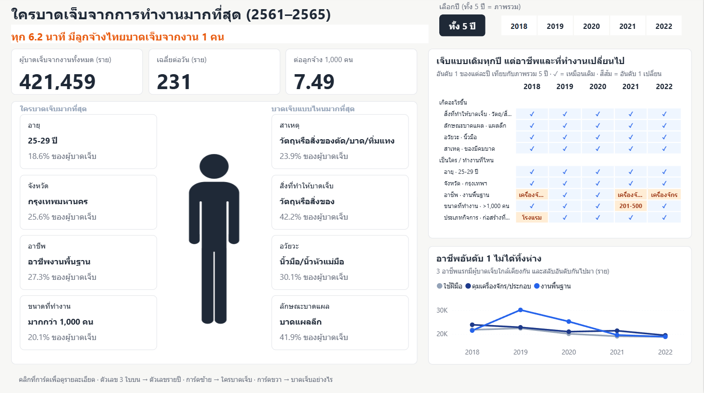
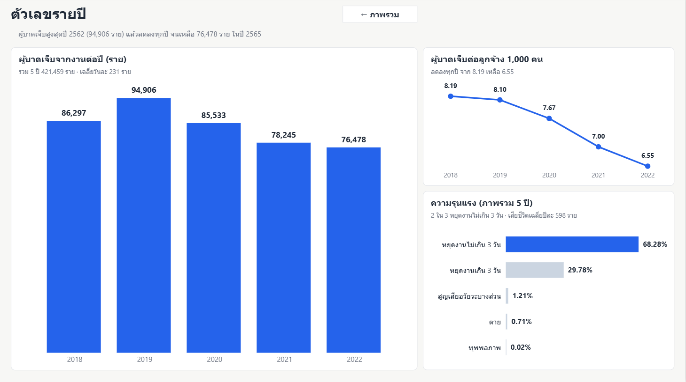
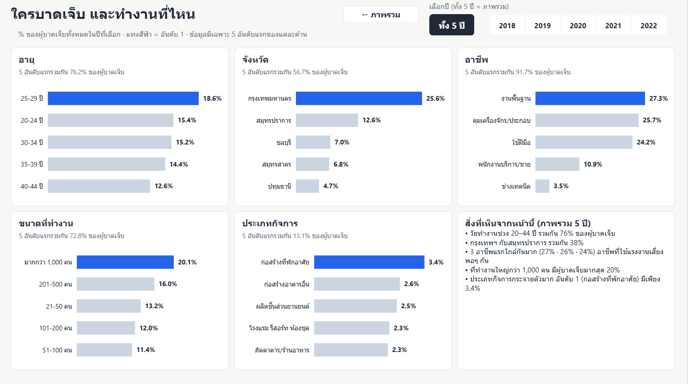
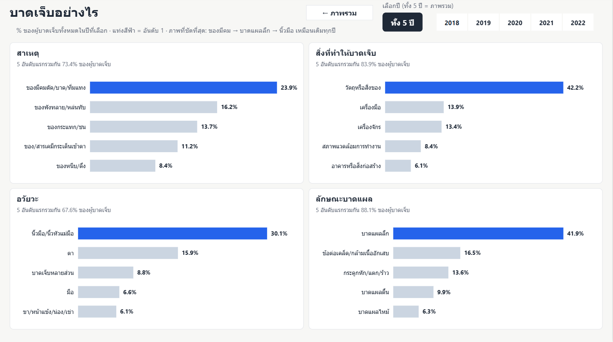

# CCTV-safety · ใครบาดเจ็บจากการทำงานมากที่สุด (2561–2565)

Dashboard เชิงเล่าเรื่องใน Power BI (`powerbi/CCTV-safety.pbip`) มี 4 หน้า ตัวเลือกปีผูกกันทุกหน้า และคลิกการ์ดในหน้าแรกเพื่อไปหน้ารายละเอียดได้

### 1. ภาพรวม

### 2. ตัวเลขรายปี

### 3. ใครบาดเจ็บ และทำงานที่ไหน

### 4. บาดเจ็บอย่างไร

## แหล่งที่มาข้อมูล

สำนักงานกองทุนเงินทดแทน สำนักงานประกันสังคม, *สถานการณ์การประสบอันตรายหรือเจ็บป่วยเนื่องจากการทำงาน ปี 2561–2565* (พิมพ์ พ.ค. 2566)
<https://www.ohswa.or.th/attachments/view/?attach_id=359766>
